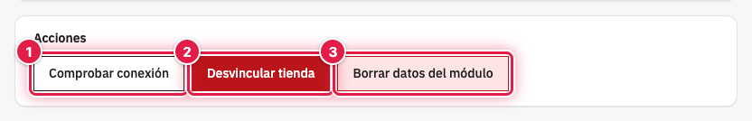
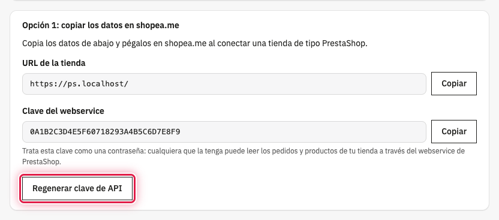

Con la tienda vinculada, la página **Shopeame** muestra la sección **Acciones** con tres botones: comprobar que la
conexión con shopea.me funciona, desvincular la tienda o borrar solo los datos de conexión guardados en PrestaShop.
Mientras no está vinculada, la misma página permite volver a generar la clave del webservice.

## ⚡ Las acciones de la tienda vinculada

Ve a **Configurar** → **Shopeame**. En **Acciones** tienes **Comprobar conexión** (1), **Desvincular tienda** (2) y
**Borrar datos del módulo** (3).

## 🔍 Comprobar la conexión

Pulsa **Comprobar conexión**. Si shopea.me reconoce la tienda, aparece **La conexión con shopea.me funciona
correctamente.**; si no, **No se pudo confirmar la conexión con shopea.me.** (consulta la página de errores).

## 🔌 Desvincular la tienda

1. Pulsa **Desvincular tienda**.
2. Acepta el aviso **Esta acción desvinculará la tienda de Shopeame. ¿Quieres continuar?**.

La tienda se da de baja en shopea.me, deja de sincronizar pedidos y PrestaShop borra los datos de la vinculación. El
aviso **Tienda desvinculada de shopea.me.** lo confirma. Si shopea.me no responde, verás **Se borraron las credenciales
locales, pero shopea.me no confirmó la desvinculación.**: la tienda queda desvinculada en PrestaShop y puedes
desvincularla también desde shopea.me.

La clave del webservice se conserva, así que puedes volver a vincular la tienda cuando quieras. Si lo haces con el
mismo ERP, shopea.me la reactiva con su configuración.

## 🧹 Borrar los datos del módulo

Usa **Borrar datos del módulo** cuando hayas desvinculado o borrado la tienda desde shopea.me, o cuando hayas
restaurado una copia de la tienda con datos de otra vinculación.

1. Pulsa **Borrar datos del módulo**.
2. Acepta el aviso **Esta acción solo borrará los datos de conexión guardados en el módulo y no modificará Shopeame.
   ¿Quieres continuar?**.

Solo se borran los datos de la vinculación guardados en PrestaShop, sin avisar a shopea.me y sin tocar la clave del
webservice. Aparece **Se borraron los datos de conexión guardados en el módulo sin modificar shopea.me.** y la página
vuelve a mostrar las dos formas de vincular.

## 🔑 Regenerar la clave del webservice

Con la tienda sin vincular, la **Opción 1** muestra el botón **Regenerar clave de API**. Al pulsarlo se borra la clave
anterior del módulo y se crea otra nueva; shopea.me deja de poder usar la antigua.

⚠️ Después de regenerarla, vuelve a vincular la tienda para que shopea.me reciba la clave nueva.

## Ver también

- [Cómo vincular PrestaShop copiando los datos en shopea.me](como-vincular-prestashop-copiando-los-datos-en-shopeame.md)
- [Cómo vincular PrestaShop con el UUID y el token del ERP](como-vincular-prestashop-con-el-uuid-y-el-token-del-erp.md)
- [Cómo resolver los errores de Shopeame en PrestaShop](como-resolver-los-errores-de-shopeame-en-prestashop.md)
