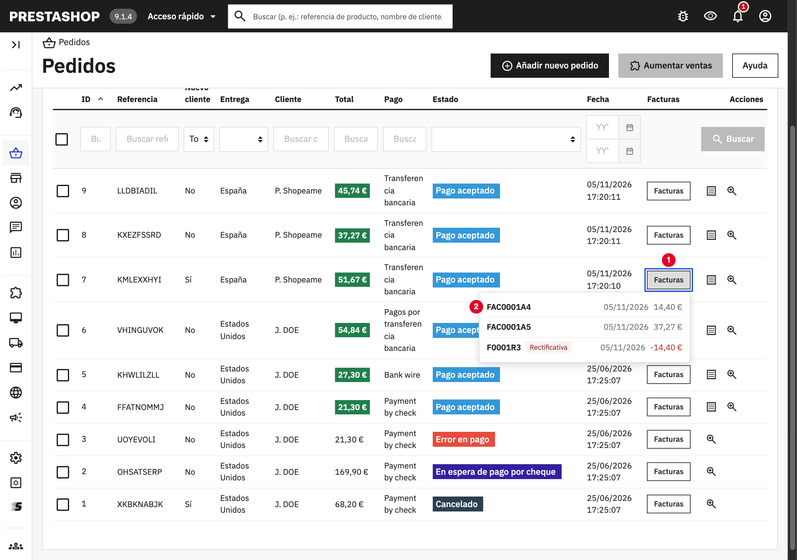
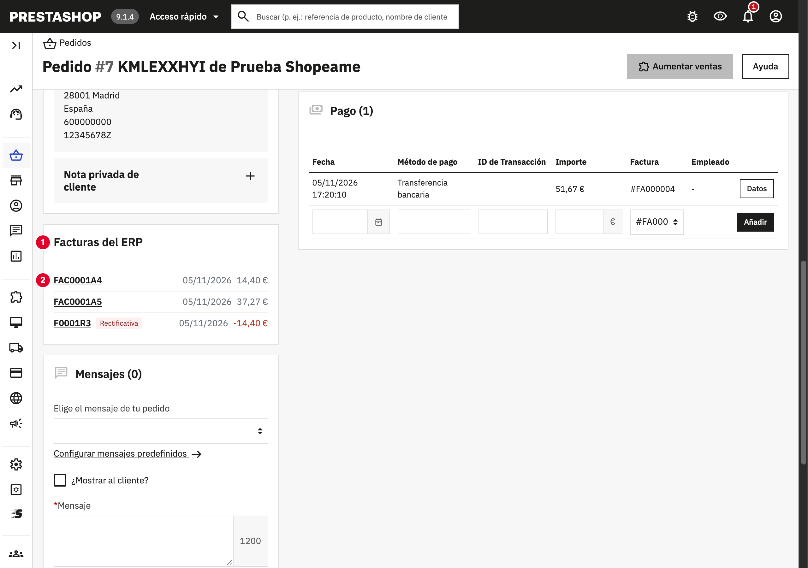
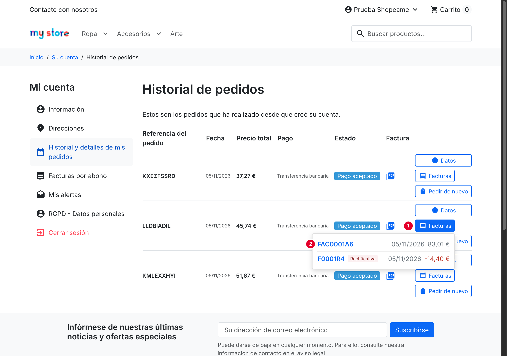
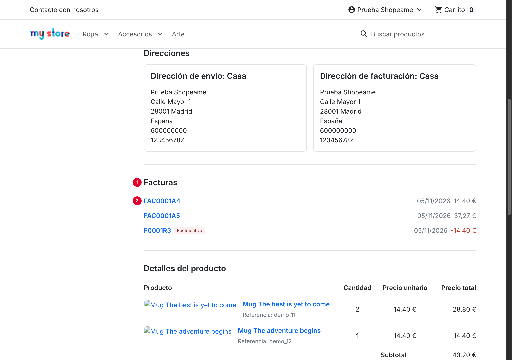
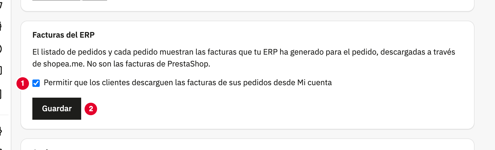

Cuando facturas en tu ERP un pedido que llegó desde la tienda, puedes descargar sus facturas en PDF desde el propio
PrestaShop, sin entrar en el ERP, y tus clientes pueden descargarlas desde **Mi cuenta**. Aparecen todas las facturas
del pedido: las facturas parciales, la factura que agrupa ese pedido con otros del mismo cliente y las facturas
rectificativas.

En la ficha del pedido y en la configuración se llaman **Facturas del ERP** para no confundirlas con las facturas que genera el propio
PrestaShop (las que salen en **Pedidos** → **Facturas** y en la pestaña **Documentos** del pedido, numeradas
`#FA000001`...). Son independientes: el módulo no toca las facturas de PrestaShop.

## ⚙️ Antes de empezar

- La tienda está vinculada con shopea.me y el pedido ya ha llegado a tu ERP.
- El pedido está facturado en el ERP (si todavía no lo está, la lista sale vacía).
- Tu ERP está encendido y con conexión: las facturas se piden al ERP en el momento.
- Entras en PrestaShop con un empleado que puede ver los pedidos.

## 📋 Desde el listado de pedidos

1. Ve a **Pedidos** → **Pedidos**.
2. En la columna **Facturas**, pulsa el botón **Facturas** del pedido (1). El pedido no se abre.
3. Se abre una lista con las facturas del pedido: código, fecha y total. Las rectificativas llevan la etiqueta
   **Rectificativa** y el total en rojo; si pasas el ratón por la etiqueta, verás qué factura rectifican.
4. Pulsa el código de una factura (2) para descargar su PDF. El archivo se llama como la factura, por ejemplo
   `FAC0001A4.pdf`.

Para cerrar la lista, pulsa fuera de ella o la tecla **Esc**.

## 🧾 Desde la ficha del pedido

Abre el pedido: en la columna de la izquierda, el cuadro **Facturas del ERP** (1) muestra sus facturas en cuanto se
carga la página. Pulsa el código de una factura (2) para descargar su PDF.

## 👤 Tus clientes, desde Mi cuenta

Tus clientes pueden descargar las facturas de sus propios pedidos sin pedírtelas:

- En **Mi cuenta** → **Historial y detalles de mis pedidos**, cada pedido tiene el botón **Facturas** (1) junto a
  **Datos** (o **Detalles**, según el tema), con el mismo estilo que los botones de tu tema. Al pulsarlo se despliega la lista de facturas; al
  pulsar un código (2) se descarga el PDF.
- Al ver un pedido, la sección **Facturas** (1) muestra sus facturas debajo de las direcciones; cada código (2)
  descarga su PDF.

Cada cliente solo ve las facturas de los pedidos de su cuenta. Si el ERP no responde, el cliente ve **Las facturas no
están disponibles ahora mismo. Inténtalo más tarde.**, sin más detalles.

Para que tus clientes no vean las facturas, ve a **Configurar** → **Shopeame**, desmarca **Permitir que los clientes
descarguen las facturas de sus pedidos desde Mi cuenta** (1) en la sección **Facturas del ERP** y pulsa **Guardar**
(2). Viene marcada al instalar el módulo. Desmarcada, en **Mi cuenta** no aparece nada; en el panel de PrestaShop las
facturas se siguen viendo.

## 💡 Cosas a tener en cuenta

- **Siempre están al día**: cada vez que abres la lista, shopea.me pregunta al ERP. Si creas una rectificativa o borras
  una factura en el ERP, lo verás la próxima vez que la abras.
- **Facturas que agrupan varios pedidos**: si en el ERP facturaste juntos varios pedidos del mismo cliente, esa factura
  aparece en cada uno de ellos, y también sus rectificativas.
- **Las facturas no se guardan en PrestaShop**: el PDF pasa por shopea.me hasta tu navegador.
- **Si facturas en el ERP, desactiva las facturas de PrestaShop** en **Pedidos** → **Facturas** → **Activar
  facturas**. Si no, tu cliente verá en **Mi cuenta** la columna **Factura** (la de PrestaShop) además del botón
  **Facturas** (las del ERP).

## 🚨 Si no aparecen las facturas

| Mensaje | Qué hacer |
|---|---|
| **Este pedido aún no tiene facturas en el ERP.** | El pedido no está facturado o no llegó al ERP. Revisa en el ERP que el pedido de la tienda está facturado. |
| **Tu ERP no está disponible ahora mismo. Inténtalo más tarde.** | El ERP está apagado, sin el plugin Shopeame o no responde a tiempo. Cuando vuelva a estar disponible, pulsa **Volver a cargar**. |
| **Tu ERP no permite descargar facturas. Actualiza FacturaScripts y el plugin Shopeame.** | Actualiza FacturaScripts y el plugin Shopeame del ERP. |
| **shopea.me todavía no permite descargar facturas.** | shopea.me aún no tiene esta función. Prueba más adelante. |
| **La factura ya no pertenece a este pedido. Vuelve a cargar las facturas.** | La factura se ha cambiado o borrado en el ERP desde que abriste la lista. Vuelve a abrirla. |
| **La tienda no está vinculada con shopea.me.** | Ve a **Configurar** → **Shopeame** y pulsa **Comprobar conexión**; si hace falta, vuelve a vincular la tienda. |
| **No se ha podido conectar con shopea.me. Inténtalo de nuevo en unos minutos.** | Tu servidor no ha podido conectar con shopea.me. Espera y vuelve a intentarlo. |

Los fallos también se anotan en **Parámetros Avanzados** → **Registros/Logs**, en los mensajes que empiezan por
`Shopeame:`.

## Ver también

- [Cómo funciona el módulo Shopeame para PrestaShop](como-funciona-shopeame-para-prestashop.md)
- [Cómo resolver los errores de Shopeame en PrestaShop](como-resolver-los-errores-de-shopeame-en-prestashop.md)
