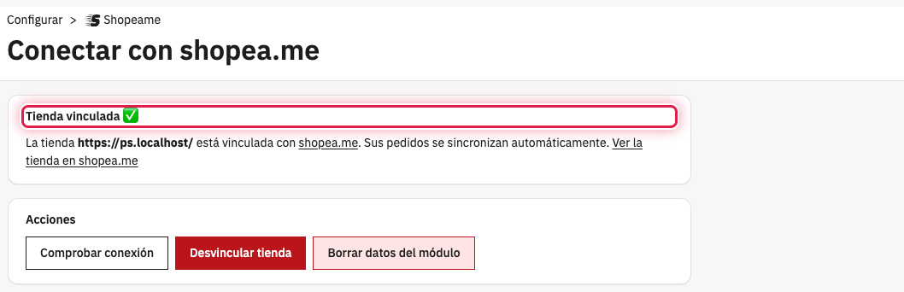

El módulo **Shopeame** conecta tu tienda PrestaShop con shopea.me, el servicio que lleva los pedidos de tu tienda
online a tu ERP. Una vez vinculada la tienda, cada pedido nuevo o modificado se avisa a shopea.me al momento, y
shopea.me lo descarga y lo crea en el ERP sin que tengas que copiar nada a mano.

Para que shopea.me pueda leer los pedidos y mantener al día el catálogo, el stock y los precios, el módulo activa el
webservice de PrestaShop y crea una clave solo para shopea.me, con los permisos justos: puede leer los pedidos y los
datos que necesita para copiarlos (clientes, direcciones, países, monedas…) y crear o actualizar productos, variantes,
stock, precios, categorías y atributos, pero no puede borrar nada ni acceder a empleados, carritos u otros datos.

## ⚙️ Antes de empezar

- Una tienda PrestaShop 9 servida por HTTPS.
- Una cuenta en shopea.me con tu ERP ya registrado.

## 🔄 Cómo funciona

1. Instalas el módulo, que añade la entrada **Shopeame** al menú **Configurar** del panel de PrestaShop.
2. Vinculas la tienda con tu ERP de shopea.me de una de estas dos formas:
   - **Opción 1: copiar los datos en shopea.me**. Copias de PrestaShop la URL de la tienda y la clave del webservice y
     las pegas en shopea.me.
   - **Opción 2: vincular indicando tu ERP**. Copias de shopea.me el UUID y el token de tu ERP y los pegas en
     PrestaShop.
3. A partir de ahí, cada vez que se crea un pedido, cambia su estado o se edita desde el panel, el módulo avisa a
   shopea.me con el número del pedido. shopea.me lo descarga y lo lleva al ERP.

## 🔒 Qué datos se envían a shopea.me

- Al vincular: la URL de la tienda y la clave del webservice y, en la opción 2, el UUID y el token del ERP.
- Con cada pedido nuevo o modificado: solo el número del pedido. El resto de datos (cliente, direcciones, productos y
  totales) los lee shopea.me por el webservice con su clave.
- Antes de vincular la tienda, el módulo no envía nada.

Si desinstalas el módulo desde **Módulos** → **Gestor de módulo**, se borran sus datos y la clave del webservice que
creó, y shopea.me deja de tener acceso a la tienda.

## Ver también

- [Cómo instalar el módulo Shopeame en PrestaShop](como-instalar-el-modulo-shopeame-en-prestashop.md)
- [Cómo vincular PrestaShop copiando los datos en shopea.me](como-vincular-prestashop-copiando-los-datos-en-shopeame.md)
- [Cómo vincular PrestaShop con el UUID y el token del ERP](como-vincular-prestashop-con-el-uuid-y-el-token-del-erp.md)
