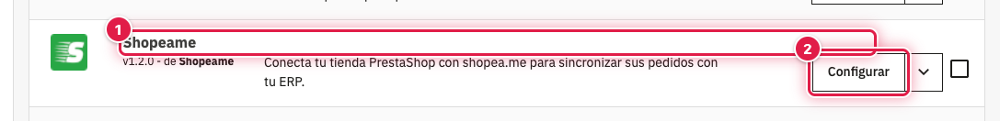
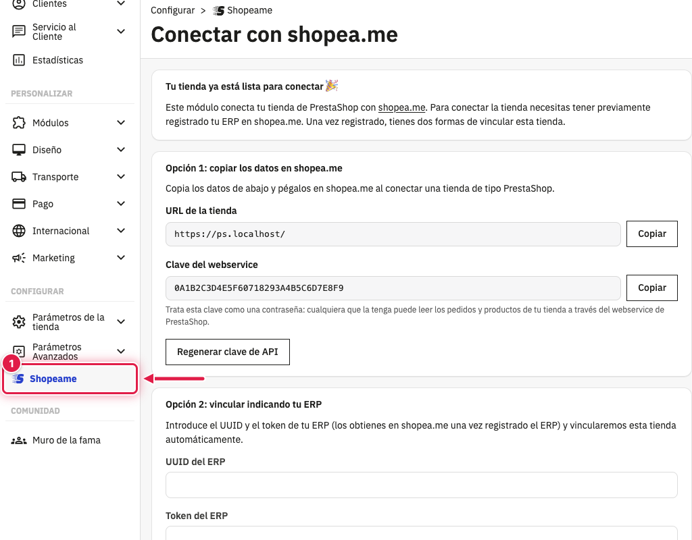

El módulo **Shopeame** se instala como cualquier otro módulo de PrestaShop, desde el catálogo de módulos o subiendo
el archivo zip descargado de PrestaShop Addons. Funciona en PrestaShop 9.

## ⚙️ Antes de empezar

- Entra en el panel de PrestaShop con un empleado que tenga permiso para gestionar módulos.
- Ten a mano el archivo zip del módulo si lo has descargado de PrestaShop Addons.

## 📥 Instalar el módulo

1. Ve a **Módulos** → **Gestor de módulo**.
2. Pulsa **Subir un módulo** y arrastra el zip, o búscalo en el catálogo de módulos y pulsa **Instalar**.
3. Espera al aviso de que el módulo se ha instalado correctamente.

En **Módulos** → **Gestor de módulo** verás el módulo **Shopeame** (1) con el botón **Configurar** (2), que abre su
página.

## 🧭 Abrir la página del módulo

Al instalarlo aparece la entrada **Shopeame** (1), con el logo de Shopeame, en la sección **Configurar** del menú
lateral. Desde ahí se vincula la tienda con shopea.me y se gestiona la conexión.

Mientras la tienda no está vinculada, la página **Conectar con shopea.me** muestra **Tu tienda ya está lista para
conectar 🎉** y las dos formas de vincularla.

## Ver también

- [Cómo funciona el módulo Shopeame para PrestaShop](como-funciona-shopeame-para-prestashop.md)
- [Cómo vincular PrestaShop copiando los datos en shopea.me](como-vincular-prestashop-copiando-los-datos-en-shopeame.md)
- [Cómo vincular PrestaShop con el UUID y el token del ERP](como-vincular-prestashop-con-el-uuid-y-el-token-del-erp.md)
