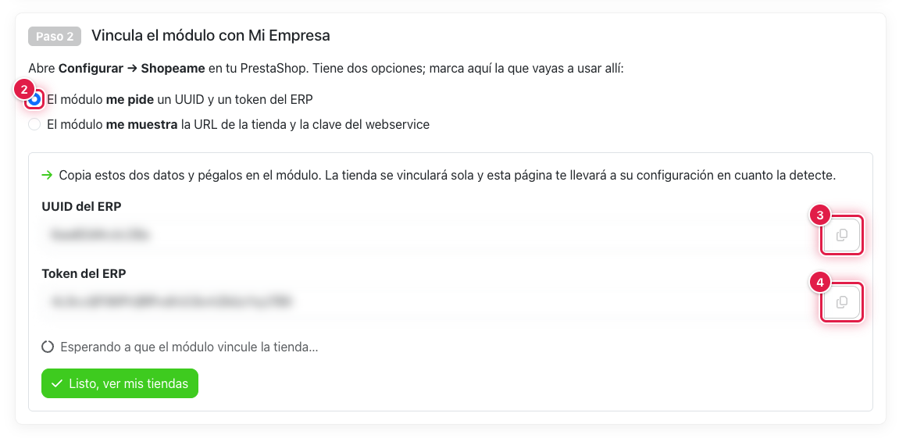
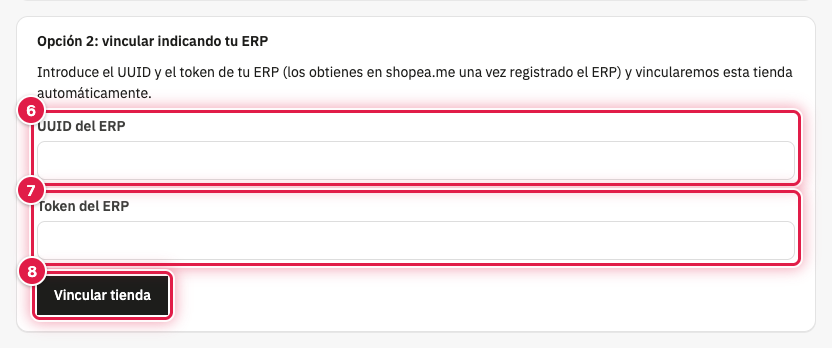
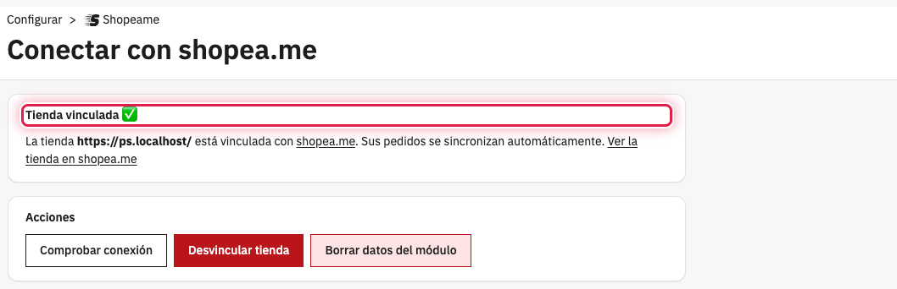

Con esta opción copias de shopea.me el UUID y el token de tu ERP y los pegas en PrestaShop. El módulo genera solo la
clave del webservice si aún no existe, registra la tienda en shopea.me y guarda los datos de la vinculación.

## ⚙️ Antes de empezar

- El módulo Shopeame instalado.
- Tu ERP registrado en shopea.me.

## 📋 Copiar el UUID y el token del ERP en shopea.me

1. En shopea.me, abre tu ERP, ve a la pestaña de tiendas y pulsa **Conectar** en **Conectar una tienda online o
   marketplace**. Elige **PrestaShop**.
2. En **Paso 2**, deja marcada **El módulo me pide un UUID y un token del ERP**.
3. Copia el **UUID del ERP** con su botón de copiar.
4. Copia el **Token del ERP** con su botón de copiar.

Deja esa página abierta: muestra **Esperando a que el módulo vincule la tienda…** y te llevará a la configuración de
la tienda en cuanto la detecte.

⚠️ El token da acceso a tu ERP en shopea.me: no lo compartas.

## 🔗 Vincular la tienda en PrestaShop

5. En PrestaShop, ve a **Configurar** → **Shopeame**.
6. En **Opción 2: vincular indicando tu ERP**, pega el UUID en **UUID del ERP**.
7. Pega el token en **Token del ERP**.
8. Pulsa **Vincular tienda**.

## ✅ Qué pasa después

La página indica **Tienda vinculada ✅** con uno de estos avisos:

- **Tienda vinculada con shopea.me correctamente.**: se ha creado la tienda en tu ERP.
- **La tienda ya estaba vinculada. Se recuperaron sus datos sin crear una tienda nueva.**: la tienda ya existía en
  shopea.me (por ejemplo, si la conectaste antes con la opción 1).
- **La tienda se reactivó y quedó vinculada con shopea.me correctamente.**: la tienda se había desvinculado y se ha
  vuelto a activar con sus datos y su configuración.

En shopea.me, la página que dejaste abierta muestra **¡Tienda … conectada!** y te lleva a la configuración de la
tienda.

## ⚠️ Si no se vincula

- **El UUID del ERP no es válido.** o **El token del ERP no es válido.**: el UUID tiene 13 caracteres y el token 32,
  solo letras y números. Vuelve a copiarlos sin espacios y repite.
- **No se pudo vincular la tienda: …**: shopea.me no reconoce los datos del ERP; el texto que sigue indica el motivo.
- **No se pudo conectar con shopea.me. Error: …**: el servidor de la tienda no ha podido conectarse con shopea.me.
  Espera y repite.

## Ver también

- [Cómo vincular PrestaShop copiando los datos en shopea.me](como-vincular-prestashop-copiando-los-datos-en-shopeame.md)
- [Cómo comprobar, desvincular o borrar los datos de Shopeame en PrestaShop](como-comprobar-desvincular-o-borrar-los-datos-de-shopeame-en-prestashop.md)
- [Cómo resolver los errores de Shopeame en PrestaShop](como-resolver-los-errores-de-shopeame-en-prestashop.md)
