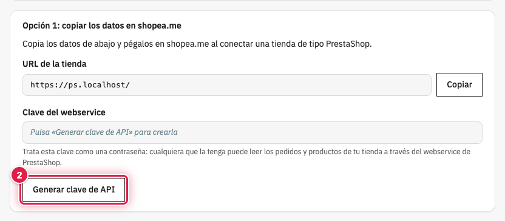
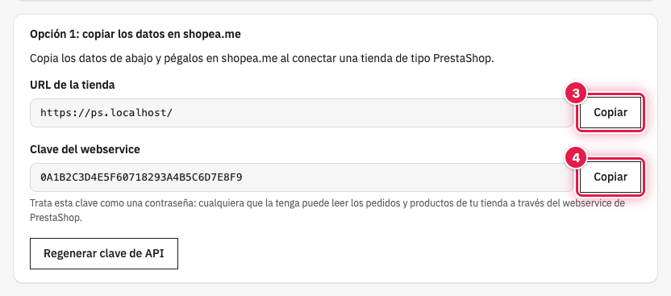
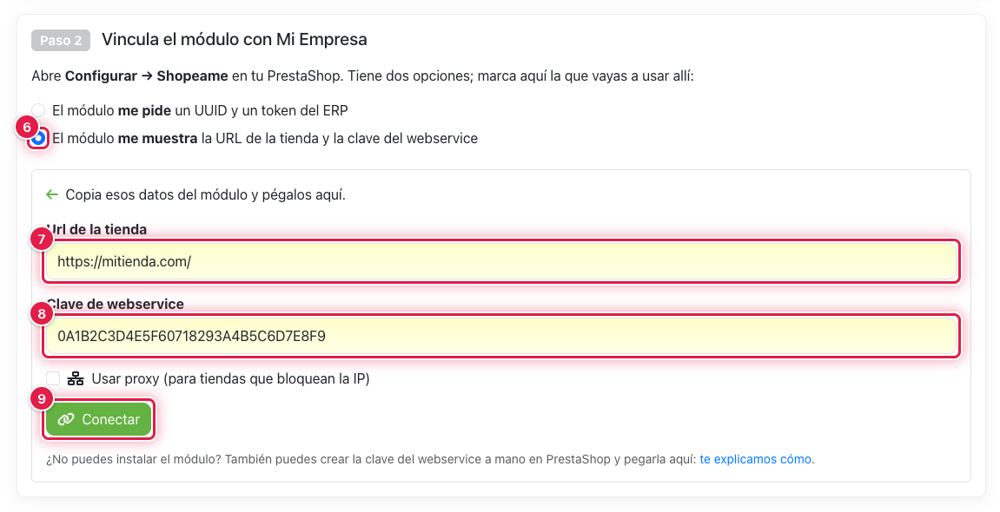
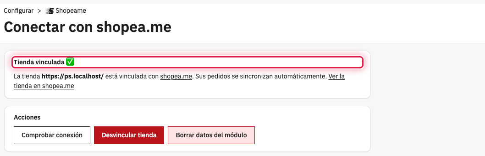

Con esta opción generas en PrestaShop la clave del webservice y la pegas en shopea.me junto con la URL de la tienda.
shopea.me comprueba que puede conectarse, crea la tienda en tu ERP y envía a PrestaShop los datos de la vinculación,
así que no tienes que volver a PrestaShop para terminar.

## ⚙️ Antes de empezar

- El módulo Shopeame instalado.
- Tu ERP registrado en shopea.me.

## 🔑 Generar y copiar los datos en PrestaShop

1. Ve a **Configurar** → **Shopeame**.
2. En **Opción 1: copiar los datos en shopea.me**, pulsa **Generar clave de API**.

Aparece el aviso **Clave de API generada correctamente.** y se rellena la **Clave del webservice**. Si el webservice
de PrestaShop estaba desactivado, el módulo lo activa.

3. Pulsa **Copiar** junto a **URL de la tienda**.
4. Pulsa **Copiar** junto a **Clave del webservice**.

Pega los datos de uno en uno en shopea.me (pasos siguientes), o guárdalos un momento en un lugar seguro.

⚠️ Trata esta clave como una contraseña: con ella se puede acceder a los pedidos, los productos y los clientes de tu
tienda. No la borres en **Parámetros Avanzados** → **Webservice**: shopea.me dejaría de poder sincronizar la tienda.

## 🔗 Pegar los datos en shopea.me

5. En shopea.me, abre tu ERP, ve a la pestaña de tiendas y pulsa **Conectar** en **Conectar una tienda online o
   marketplace**. Elige **PrestaShop**.
6. En **Paso 2**, marca **El módulo me muestra la URL de la tienda y la clave del webservice**.
7. Pega la URL de la tienda en **Url de la tienda**.
8. Pega la clave en **Clave de webservice**.
9. Pulsa **Conectar**.

shopea.me muestra **La tienda ha sido conectada correctamente. Ahora debes terminar de configurar tus opciones.** y te
lleva a la configuración de la tienda.

## ✅ Comprobar la vinculación

Vuelve a **Configurar** → **Shopeame** en PrestaShop: ahora indica **Tienda vinculada ✅**. Desde ese momento los
pedidos se sincronizan solos.

Si la página sigue mostrando las dos opciones, shopea.me no ha podido enviar los datos a PrestaShop (por ejemplo,
porque la tienda no usa HTTPS o un cortafuegos bloquea la petición). La tienda sí está creada en shopea.me: termina la
vinculación con la opción 2, con el UUID y el token de tu ERP; el módulo recupera la tienda existente sin crear otra.

## Ver también

- [Cómo vincular PrestaShop con el UUID y el token del ERP](como-vincular-prestashop-con-el-uuid-y-el-token-del-erp.md)
- [Cómo comprobar, desvincular o borrar los datos de Shopeame en PrestaShop](como-comprobar-desvincular-o-borrar-los-datos-de-shopeame-en-prestashop.md)
- [Cómo resolver los errores de Shopeame en PrestaShop](como-resolver-los-errores-de-shopeame-en-prestashop.md)
